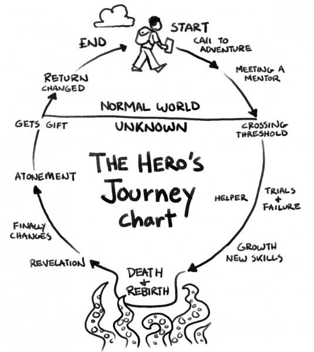

# Storytelling

## What I learn about it ?  

- The Seven basic stories : 
  - overcoming the monster
  - rags to riches 
  - the quest
  - voyage and return 
  - comedy
  - tragedy
  - rebirth

- Kishotenketsy 

- ... writing on the carnet 

## Documentations : 

- 
- (https://viterbigradadmission.usc.edu/2017/07/heros-journey-joseph-campbell/)

- Morphologie of the folktale- V.propp

- Philosophy if the Humanities - Victor Gijsberg 

- The Carrier bag theory of fiction - Urusla k.le Guin
  
- [Campbell inspiration for George Lucas](https://www.jcf.org/learn/star-wars)

- [Japonese Tail YUKI](https://yokai.com/yukionna/?srsltid=AU7gw4Uq_u_dqDoSpLlGiE4UbQX3jAYApUU0bSzRF89u_-mjj_JhVklx)
- https://hyakumonogatari.com/2013/12/17/yuki-onba-and-yukinko-the-snow-mother-and-the-snow-child/

- The fog - movie

- [Possible worlds](https://plato.stanford.edu/entries/possible-worlds/)

- https://luisnavarrete.com/USC/pdf/Marie_Laure_Ryan.pdf

- [Icon's movie](https://www.themarginalian.org/2013/01/23/life-in-five-seconds-h-57/)

- [book speculative everything anthony dunne & fiona raby](https://cdn.bookey.app/files/pdf/book/en/six-walks-in-the-fictional-woods.pdf)

- [playdate](https://help.play.date/developer/dev-links/)

- [ID cards](https://chloedesmoineaux.surf/T-I-N-A)