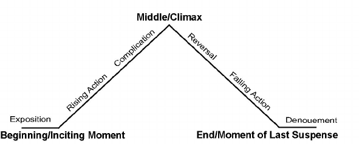
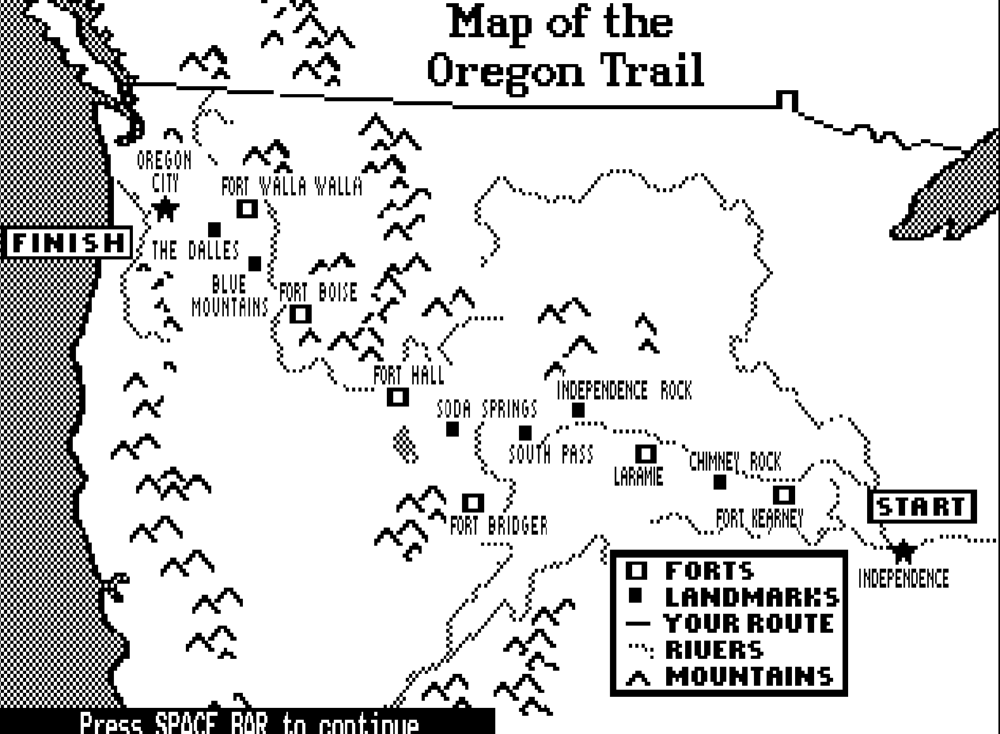

# Storytelling (part2)

## Documentations 

- [character creator deck](https://www.kickstarter.com/projects/fatumcards/fatum-character-creator-deck/?ref=kicktraq)

- 

- [book Narrating space / spatializing narrative where narrative theory and geography meet](https://www.researchgate.net/publication/318221384_Narrating_SpaceSpatializing_Narrative_Where_Narrative_Theory_and_Geography_Meet)

- [Oregon trail game](https://oregontrail.ws/games/the-oregon-trail)
  

- [orphée & Eurydice](https://www.iletaitunehistoire.com/genres/contes-et-legendes/lire/biblidcon_076#histoire)
- [don't look back game](https://www.newgrounds.com/portal/view/486660)

- [the graveyard](https://store.steampowered.com/app/27020/The_Graveyard/)

- [Le train](https://mastermediadesign.itch.io/the-train)

- [lieve oma](https://vltmn.itch.io/lieve-oma)
- [Florence](https://store.steampowered.com/app/1102130/Florence/)

- [podcast scriptnotes](https://scriptnotes.net/)