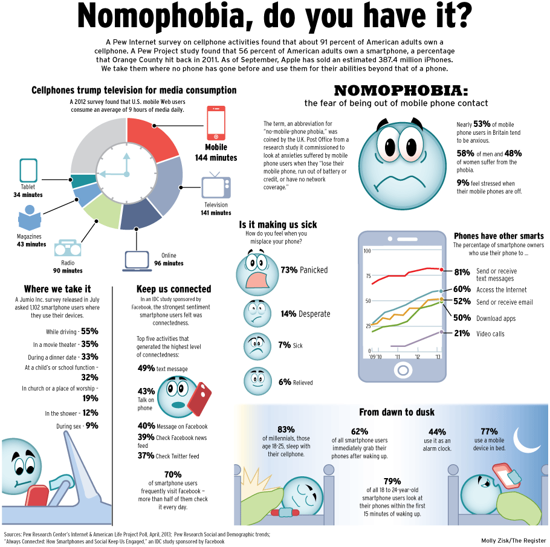
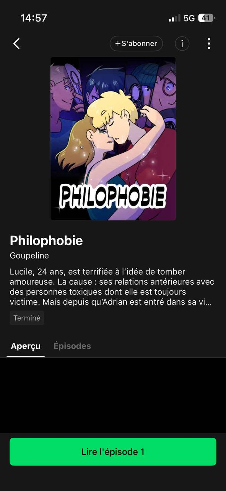
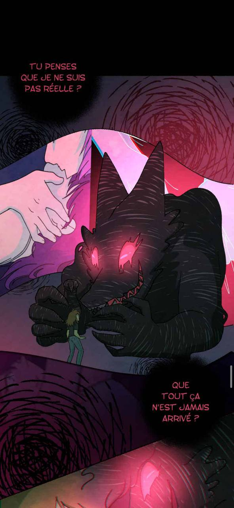
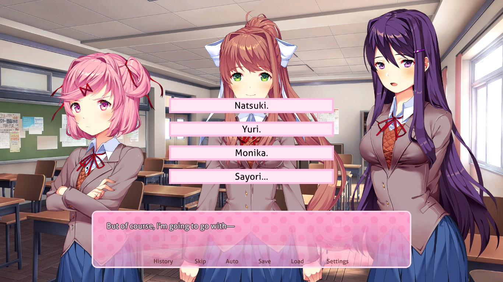
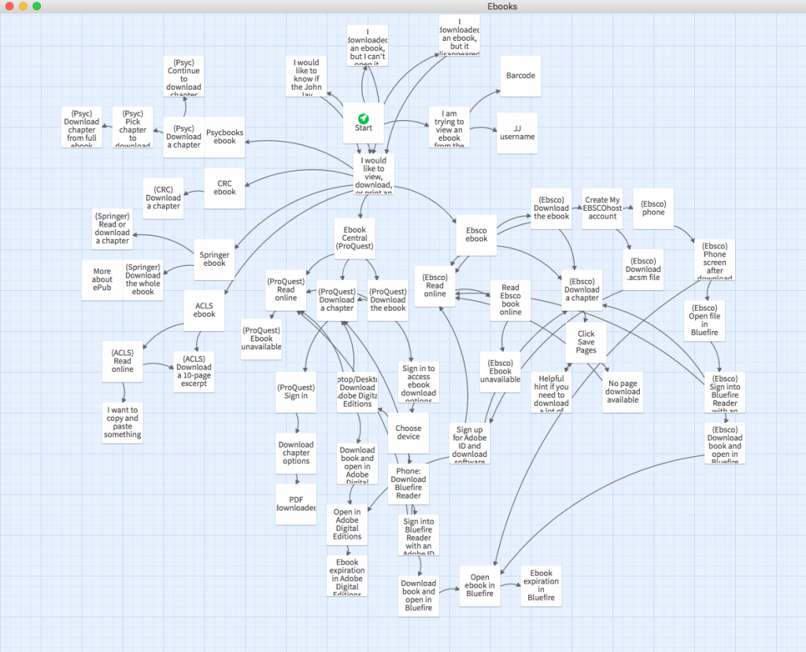

# Nomophobia 
What is Nomophobia : irrational fear, anxiety, or panic caused by being without a mobile phone. 

Nomophobia increase especially cyber-perpetration behaviours and both phenomena are associated with psychopathology dimensions such as emotional problems, hyperactivity, conduct problems and total problems. 

## Pitch 

**Nomophobia** is a psychological game that explores the **anxiety** and **fear** caused by cyberbullying and the inability to disconnect from social media. 

Players face seemingly simple choices, such as turning off their phone or ignoring hurtful messages, but find themselves trapped in a **loop** of fear, notifications, and online harassment.

Their goal is to **break** this cycle by **overcoming** their anxiety and regaining control over their digital lives.

## Inspirations

- Where does fear, anxiety, depression, loneliness come from and how they can be represented ? 

- webtoon : **Philophobie** " where mental health traumas like anxiety are personified and brought to life as monsters.
  

- visual novel : interaction game with a story-driven game. The text and the **choices** will be **based** on the **progression** of the gamer. 

  

- I want to take inspiration from the game mechanic of a visual novel but more poetic movie not all narative. Follow a character, observe, click on items, make choices...

- [twinery](https://twinery.org/): help to visualize Branching Stories: 
  
  I like the idea of **having different endings** depending on the choice made during the game 

    

- I like the idea of having easter egg, like depending  on how observer the gamer is, the choices will be different. 

- [declick](https://declick.ch/secondaire-i-ii/)
"La nomophobie désigne la peur irrationnelle, l'angoisse ou le sentiment de panique ressentis à l'idée d'être séparé de son téléphone mobile ou de ne pas pouvoir l'utilise"

- [nomophobia and cyberbullying](https://www.sciencedirect.com/science/article/abs/pii/S074756322030248X)
- [Nomophobia and cyber‐bullying, interplay and association with psychopathological risk](https://iris.unisob.na.it/handle/20.500.12570/13308)

- [Just kidding game](https://better-internet-for-kids.europa.eu/en/resource-directory/lappa-lentaajust-kidding-interactive-learnig-game)
  
