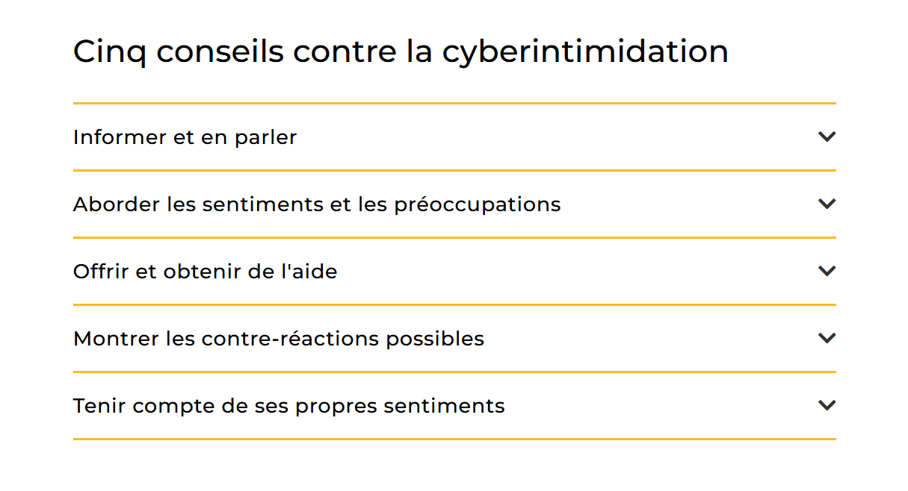
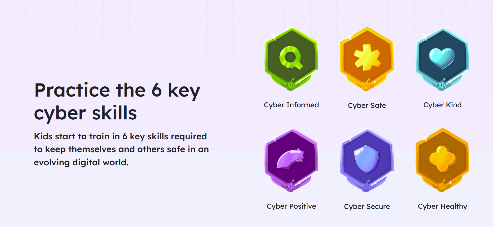

# Ideas research 

## Link research 

- [kinderschutz cyberharcelement](https://www.kinderschutz.ch/fr/themes/violence-sexuelle/developpement-sexuel-et-violences-sexuelles-numeriques/violence-sexuelle-numerique/cyberharcelement)

"Faites attention à votre utilisation personnelle des médias et d’Internet : vous êtes un modèle pour votre enfant – en ligne aussi."
"Un tel incident peut provoquer de la honte chez l’enfant. Peut-être qu’il/elle ne veut pas vous en parler au début. Il est important de rechercher le dialogue et de continuer à échanger. Faites savoir à votre enfant qu’il/elle n’est pas responsable de cet incident et n’est pas seul·e."  
"En cas de harcèlement important, il convient de conserver les preuves "
"Il se peut que votre enfant ressente de la honte, des doutes et un sentiment d’impuissance. Les victimes éprouvent souvent aussi un fort sentiment de culpabilité. Aidez-le/la à gérer ces émotions"

- [projuventute cyberharcelement](https://www.projuventute.ch/fr/parents/medias-et-internet/ensemble-contre-le-cyberharcelement)

"Le (harcèlement) intimidation et la cyberintimidation ont un impact négatif énorme sur la santé psychique de la personne ciblée. Il laisse des traces dans le parcours de vie de ces personnes. Le harcèlement-intimidation n'affecte pas seulement la personne cible, mais aussi les spectateurs ou l'auteur de l'intimidation.
Le harcèlement-intimidation peut être un phénomène de groupe - la plupart du temps ,il se produit dans un groupe qui reste ensemble pendant une longue période."

" si les enfants expriment qu'ils sont auteurs d'harcèlement-intimidation, les parents peuvent les aider à arrêter ce comportement. Il est important que les sentiments éventuels des parents, par exemple la honte, la déception ou le surmenage"

- [skppsc cyberharcelement](https://www.skppsc.ch/fr/sujets/internet/cyberharcelement/ )

"Le cyberharcèlement est toujours lié à un manque de compétences sociale et médiatique. Les auteurs manquent d’empathie pour la victime ou sont indifférents à ce qu’ils font. Les harceleurs renforcent leur position dans le groupe en rabaissant ou en insultant certains individus. Bien souvent, l’auteur n’a pas conscience que tous les actes interdits hors de la sphère d’Internet sont aussi punissables lorsqu’ils sont commis en ligne."

- [declick](https://declick.ch/secondaire-i-ii/)
  
La nomophobie (contraction de l’anglais no-mobile-phone phobia) désigne la peur irrationnelle, l'angoisse ou le sentiment de panique ressentis à l'idée d'être séparé de son téléphone mobile ou de ne pas pouvoir l'utilise

## Detection data : 

- [ReThink](https://www.rethinkwords.com/)
ReThink is a proactive software and mobile keyboard app designed to stop cyberbullying before a hurtful message is ever sent

- [game bcn](https://play.google.com/store/apps/details?id=com.bcnresol.app&hl=en_GB)
- [bullishield](https://scispace.com/papers/bullishield-a-smart-cyberbullying-detection-and-reporting-1pn9rtxyz2
)
-[bark](https://www.bark.us/protects/bark-homepage/?srsltid=AfmBOooKSyB19j3JwmSgkWGsYkP4opS_wvHWkemDaKCK0bPKYF1cLzZQ )
Bark is a digital safety and parental control service that monitors children's online activity, filters web content, manages screen time, and tracks GPS locations

-[beacon](https://beacon.thekids.org.au/)

## Game examples : 

### Patouch 
- [patouch web](https://patouch.ch/en/home-en/ )
- [patouch game noway](https://patouch.ch/noway/) 

### Dislike 
- [dislike game](https://jeu-dislike.be/presentation-du-jeu/)

### Just kiding 
- [game](https://better-internet-for-kids.europa.eu/en/resource-directory/lappa-lentaajust-kidding-interactive-learnig-game)

### Interland 
- [game](https://beinternetawesome.withgoogle.com/fr_all/interland/)
sensibilisation about privacy and sharing 

### sport is it bullying ? 

-[game](https://game.sportsmuseum.org/)

4 different types of bullying : 
- verbal bullying : using words to hurt, teasing, name calling, mean 
- physical bullying : using body to hurt, pushing, beating someone up 
- relational bullying : using your friendships to hurt others, excluding, ignoring, spreading rumors, turn against someone 
- cyberbullying : using technology to hurt others, like sending or posting hurtful, embarrassing text or images using computers, ... devices

### Cyber legends 

- [game](https://www.cyberlegends.com/)

## Ideas keyword : 

- Parent POV : objectif chercher la discussion avec son enfant 
  
- nomophobia 

- that's not me : sensibilisation about who is really behind an account 

- what should i respond ? 
