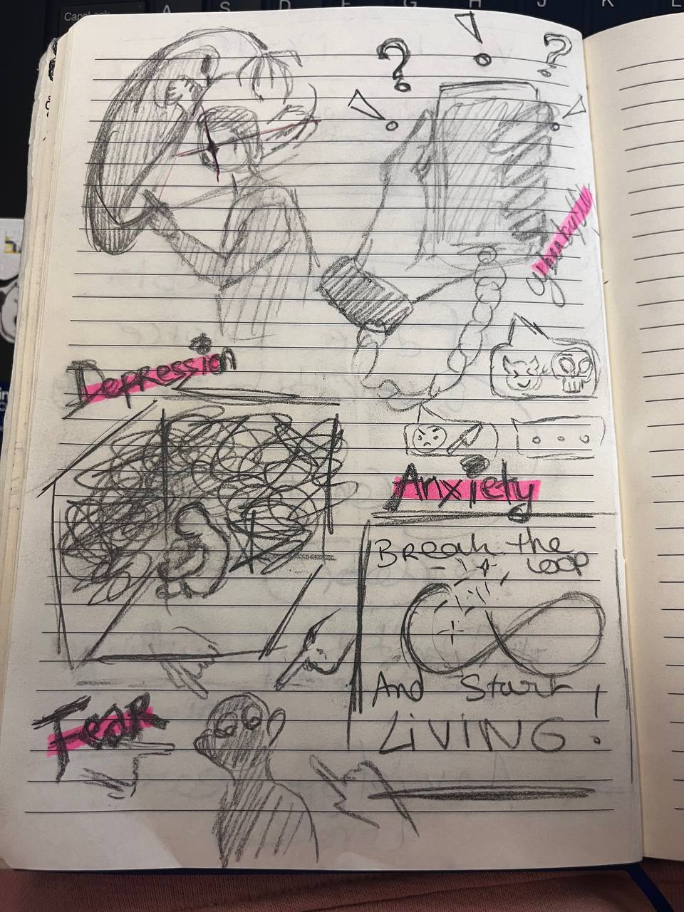
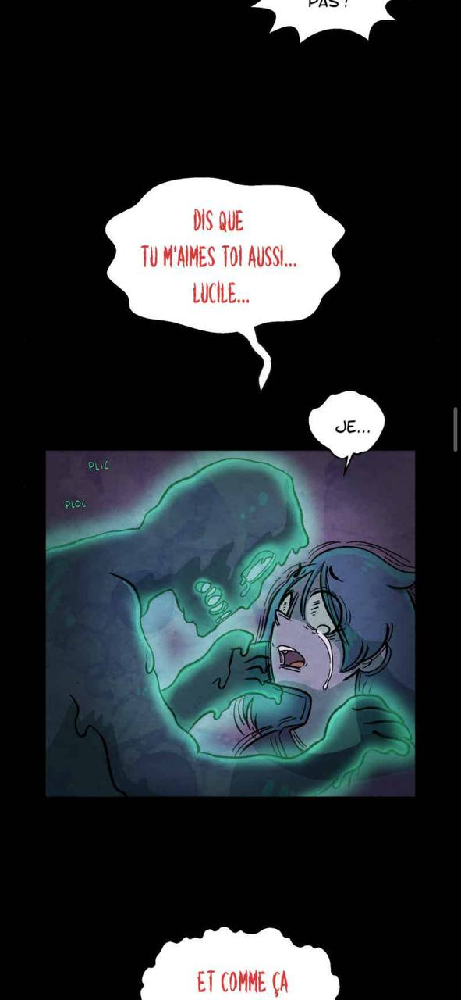

# Nomophobia 

A poetic psychological world where the invisible weight of cyberbullying becomes visible through anxiety, isolation, and the fear of disconnecting. 

## Pitch 

Discovering **Nomophobia** means exploring the invisble becoming visible.  **Anxiety**, **fear** and the inability to disconnect from social media caused by cyberbullying take a huge place

A world where the simple choices, such as turning off their phone or ignoring hurtful messages, become almost impossible. Peoples find themselves trapped in a **loop** of fear, notifications, and online harassment, unable to escape the presence that follows them everywhere. 

But is there a way out ? Can we face the monsters born from our anxiety andregaining control over their digital lives ? 

## Lists 

- **What is nomophobia** : irrational fear, anxiety, or panic caused by being without a mobile phone. 
Nomophobia increase especially cyber-perpetration behaviours and both phenomena are associated with psychopathology dimensions such as emotional problems, hyperactivity, conduct problems and total problems. 

- Walking simulators 
- Story driven game :  different ending,  choices are important, be careful of the details, 

## Inspirations

- Where does fear, anxiety, depression, loneliness come from and how they can be represented ? 

- webtoon : **Philophobie** " where mental health traumas like anxiety are personified and brought to life as monsters.

- visual novel : interaction game with a story-driven game. The text and the **choices** will be **based** on the **progression** of the gamer. 
  [doki doki litterature club](image-3.png)

- I want to take inspiration from the game mechanic of a visual novel but more poetic movie not all narative. Follow a character, observe, click on items, make choices...

- [twinery](https://twinery.org/): help to visualize [Branching Stories](image-4.png): 
  
  I like the idea of **having different endings** depending on the choice made during the game 

- I like the idea of having easter egg, like depending  on how observer the gamer is, the choices will be different. Like a [walking simulator](https://en.wikipedia.org/wiki/Walking_simulator)

- [declick](https://declick.ch/secondaire-i-ii/)
"La nomophobie désigne la peur irrationnelle, l'angoisse ou le sentiment de panique ressentis à l'idée d'être séparé de son téléphone mobile ou de ne pas pouvoir l'utilise"

- [nomophobia and cyberbullying](https://www.sciencedirect.com/science/article/abs/pii/S074756322030248X)
- [Nomophobia and cyber‐bullying, interplay and association with psychopathological risk](https://iris.unisob.na.it/handle/20.500.12570/13308)

- [Just kidding game](https://better-internet-for-kids.europa.eu/en/resource-directory/lappa-lentaajust-kidding-interactive-learnig-game)
  
- [Nomophobia, do you have it ? ](image-2.png)
