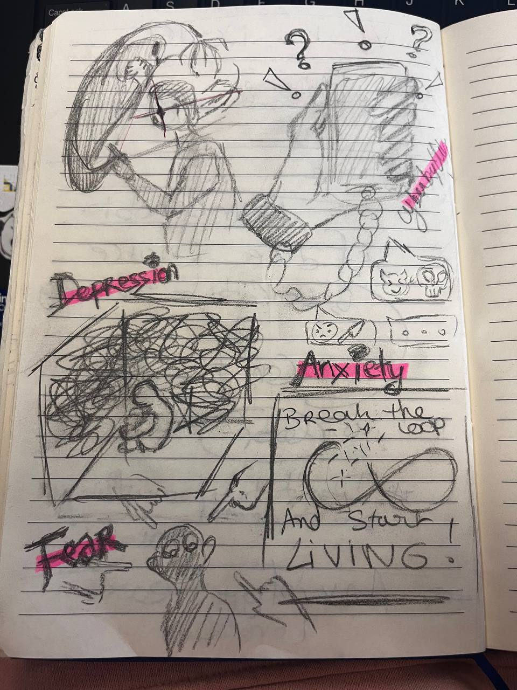
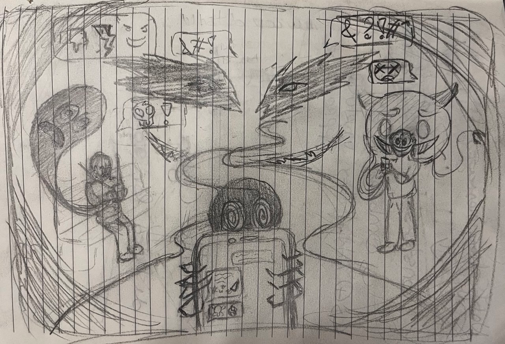
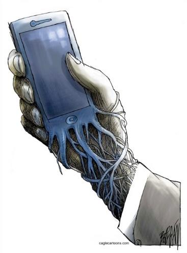
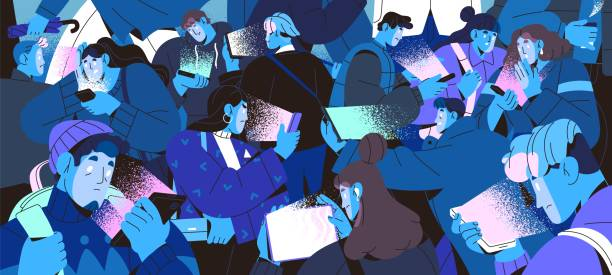
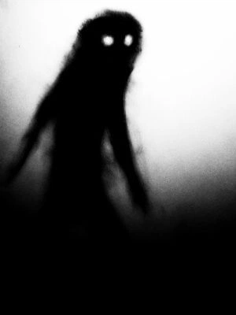
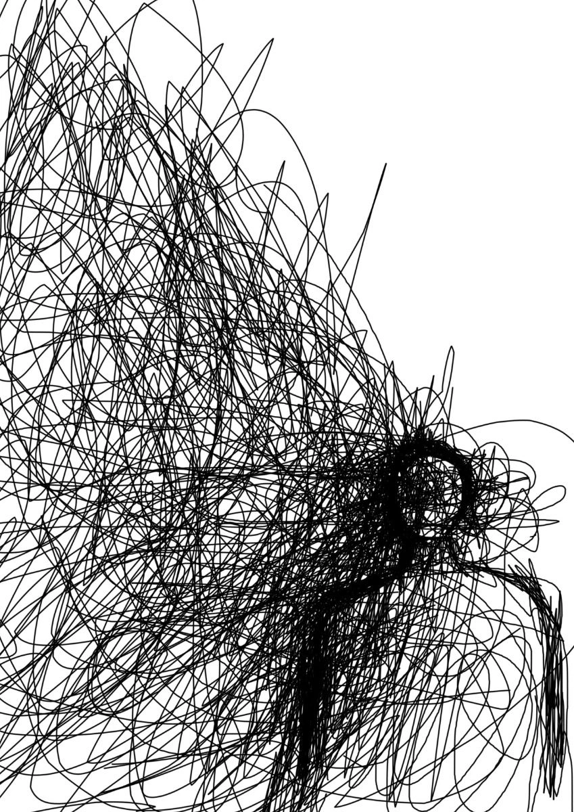
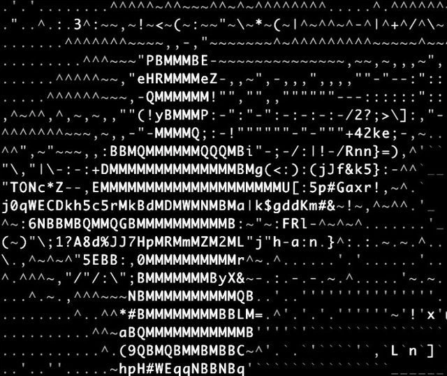
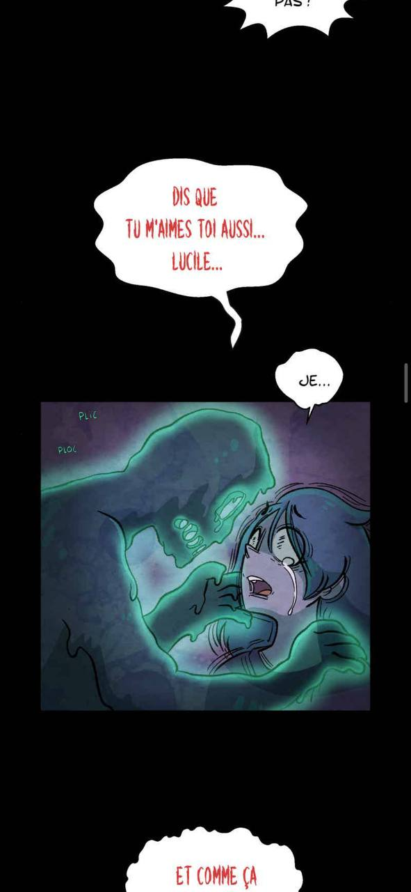
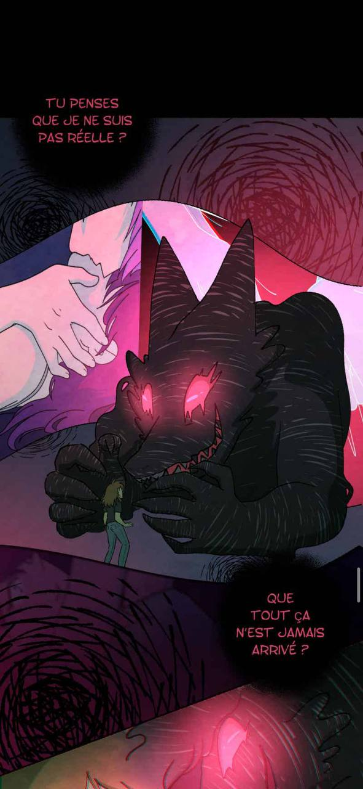
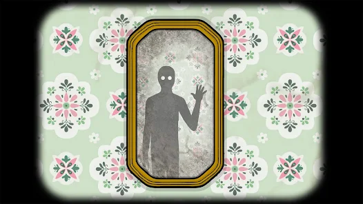

# Nomophobia 

A poetic psychological world where the invisible weight of cyberbullying becomes visible through anxiety, isolation, and the fear of disconnecting. 

## Pitch 

Discovering **Nomophobia** means exploring the invisble becoming visible.  **Anxiety**, **fear** and the inability to disconnect from social media caused by cyberbullying take a huge place

A world where the simple choices, such as turning off their phone or ignoring hurtful messages, become almost impossible. Peoples find themselves trapped in a **loop** of fear, notifications, and online harassment, unable to escape the presence that follows them everywhere. 

But is there a way out ? Can we face the monsters born from our anxiety and regaining control over their digital lives ? 

## Lists 

    1. The psychological dimension: 
      Making emotions that are normally invisible, visible.
    3. The exploratory dimension: 
      Encouraging people to observe their environment.
    4. The narrative dimension: 
      Choices influence the story and the ending 

- **Understanding Nomophobia and Cyberbullying**

  What is nomophobia? An irrational fear, anxiety, or panic caused by being without access to a mobile phone.

  The relationship between nomophobia and cyberbullying: Exploring how cyberbullying and nomophobia may reinforce one another, and how both can be associated with psychological difficulties such as emotional distress, hyperactivity, behavioural problems, and loneliness.
  
  Understanding the psychological impact: Where do fear, anxiety, depression, and loneliness come from? How can these emotions be translated into visual elements, environments, and game mechanics?

- **Walking Simulator**

  Easter eggs and environmental storytelling: I like the idea of rewarding attentive players with hidden details and alternative discoveries. Depending on how carefully the player observes their surroundings, they may uncover different elements of the story or unlock new possibilities.

- **Story driven exp**

  The narrative shaped by the player's decisions, i love it, specially when there is different endings depending on the choices they make throughout the game.

  Need to pay attention to details, objects, and dialogue.  
  [twinery](https://twinery.org/): help to visualize 

- **Gameplay inspiration**
  
  I  like mechanics from visual novels but more poetic, cinematic experience, not a fully text-based narrative.

  Visual storytelling: Not everything should be explained through dialogue or text. I want the atmosphere, environments, sounds, objects, and visual metaphors to communicate emotions and gradually reveal the story.

## Moodboard 

## Influences 

- webtoon : **Philophobie** " where mental health traumas like anxiety are personified and brought to life as monsters.

- visual novel : interaction game with a story-driven game. The text and the **choices** will be **based** on the **progression** of the gamer. 
  [doki doki litterature club](image-3.png)

- Samsara Room : the feeling when playing like a semi horror game
  

## Documents references 

- [declick](https://declick.ch/secondaire-i-ii/)
"La nomophobie désigne la peur irrationnelle, l'angoisse ou le sentiment de panique ressentis à l'idée d'être séparé de son téléphone mobile ou de ne pas pouvoir l'utilise"

- [nomophobia and cyberbullying](https://www.sciencedirect.com/science/article/abs/pii/S074756322030248X)
- [Nomophobia and cyber‐bullying, interplay and association with psychopathological risk](https://iris.unisob.na.it/handle/20.500.12570/13308)

- [Just kidding game](https://better-internet-for-kids.europa.eu/en/resource-directory/lappa-lentaajust-kidding-interactive-learnig-game)
  
- [Nomophobia, do you have it ? ](image-2.png)
